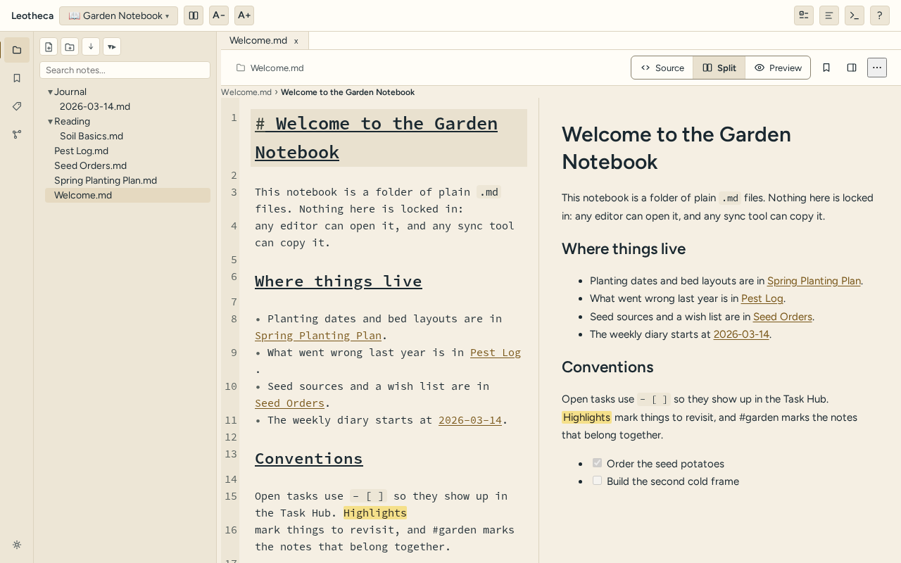
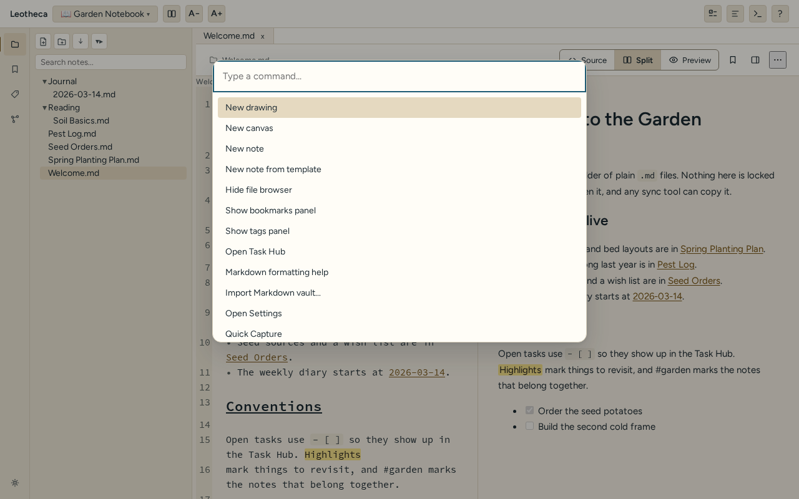
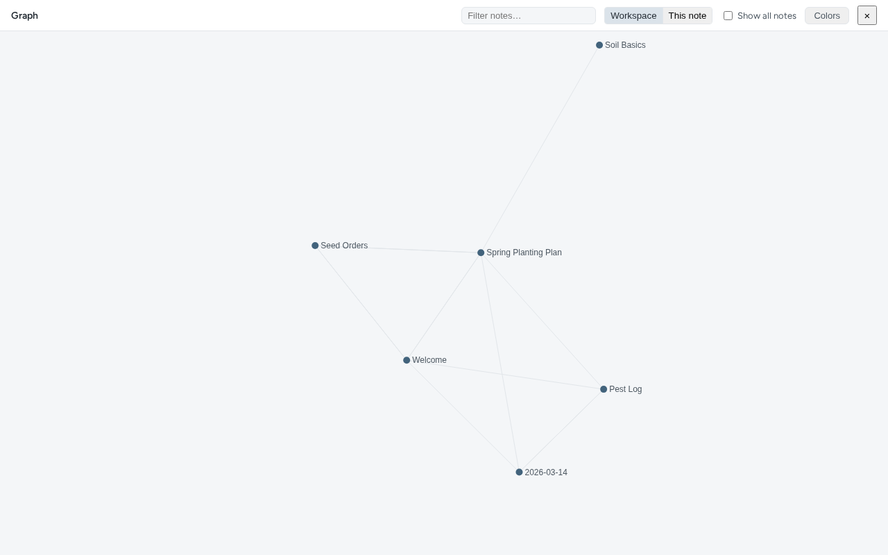
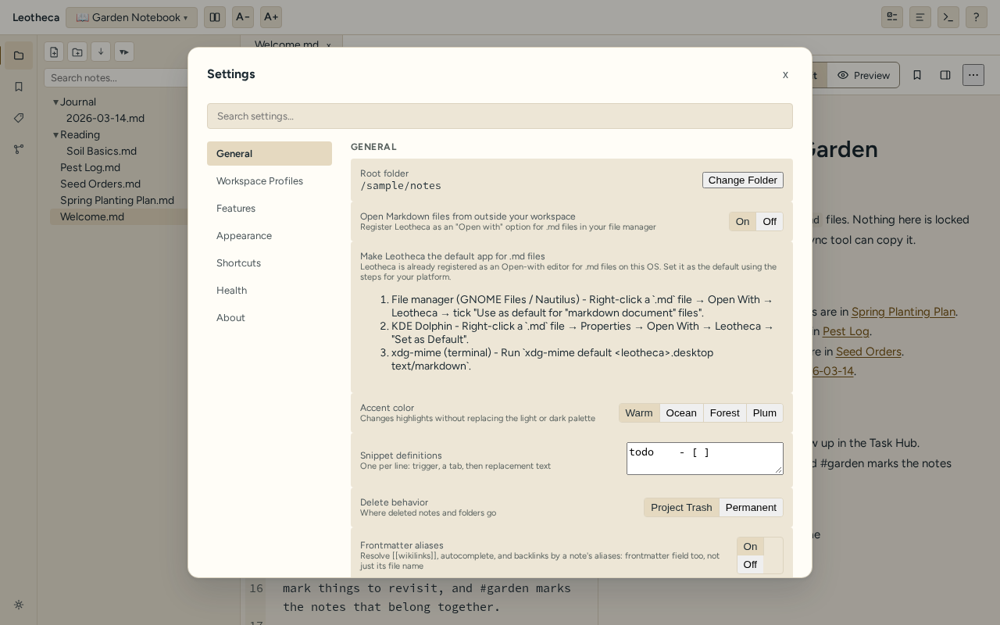

<p align="center"></p>

# Leotheca

**In short:** Leotheca is a free and open source markdown viewer and editor for a local folder of plain text notes, for Linux, macOS, Windows and Android. It is offline and private by design: **no camera, no microphone, no network**, no account, no telemetry and no sync service of its own ([how that is enforced](#why-this-exists)).
It is also a worked example of how a strong, agent-run project is built: see [why this repository is built this way](#why-this-repository-is-built-this-way).
Only a rolling dev build exists, no versioned release ([status](#status)). Build from source with [`CONTRIBUTING.md`](CONTRIBUTING.md).

[](LICENSE)
[](https://github.com/LeonardSchwier/leotheca/actions/workflows/ci.yml)


## Why this exists

Three principles govern every decision here, in order. Full detail in [`PHILOSOPHY.md`](PHILOSOPHY.md).

1. 🔓 **Free and open source, without compromise.** The full source is open under the MIT license, forever. No paid tier, no telemetry, no required account, and the app makes no network requests of its own, so it works fully offline. What backs that up:
   - The webview Content-Security-Policy in [`src-tauri/tauri.conf.json`](src-tauri/tauri.conf.json) allows only `'self'`, `asset:`, `data:` and `blob:` sources, and [`src/offline.test.ts`](src/offline.test.ts) asserts that (no `http(s)` source, no wildcard, no `unsafe-eval`). The runtime network spies in that file are only a smoke check, they do not drive the app.
   - The end-to-end fixtures in [`tests/e2e/support/fixtures.ts`](tests/e2e/support/fixtures.ts) abort and fail any request that leaves the origin while the built app runs.
   - The Android manifest, [`android/app/src/main/AndroidManifest.xml`](android/app/src/main/AndroidManifest.xml), declares no `INTERNET` permission.
   - There is no analytics or HTTP-client dependency declared in `package.json` or `src-tauri/Cargo.toml`. The Rust dependency tree of Tauri itself contains an HTTP client crate (`reqwest`) that the application code does not call.
   - Not covered: the optional [web clipper](extensions/) is a separate browser extension, and sync tools you point at your folder do their own networking.
2. 🤝 **Standing on the shoulders of giants.** Where the wider note-taking ecosystem already has a good convention (wikilinks, YAML frontmatter, a folder of plain files), this project adopts it instead of inventing a competing one.
3. 📁 **Your notes belong to you.** Plain markdown files in a folder you control, not a database, not a proprietary format. Nothing about how a note is stored depends on this application continuing to exist.

## ✨ Features

- 📂 Point it at any local folder of markdown files, no import step, no proprietary format.
- 🗂️ File tree with create, rename, delete (to a `.trash` folder, not gone for good), and a right-click context menu.
- 📑 Tabs, autosave, source-mode editing (CodeMirror 6) with a rendered Preview and Split view.
- 🔗 `[[wikilinks]]`, resolved by filename, with autocomplete while typing and a backlinks panel.
- 🕸️ A pannable, zoomable graph view of your whole workspace.
- ⭐ Bookmarks for files and saved searches.
- 🎨 A light and dark theme, following your OS by default.
- 🔍 Full-text search across the files of your vault, with folder exclusion (`-archive`). Hidden files and folders such as `.trash` are skipped.
- 🏷️ Frontmatter properties with a Properties panel, case-insensitive kanban boards, and smart collections.
- 📋 Command palette (Ctrl+K) for quick navigation and actions.
- 📤 Export a note to standalone HTML or print/PDF via the OS dialog.
- ⌨️ `==highlighted text==` with color emoji (🔴🟠🟢🔵🟣), a convention used by other Markdown note apps.
- 📊 Task Hub: read-only view of all GFM task-list items across your vault.
- 🔒 No camera, no microphone, no network: the app never records audio or video, has no voice dictation, and makes no network calls of its own. Those accesses can invade your privacy, so they are not offered.
- 📁 Open files from outside your vault, or from the OS file manager, into a read-only scratch view.
- 📱 On Android, real folder access via the Storage Access Framework.

This list is a summary, not a full inventory. [`ROADMAP.md`](ROADMAP.md) tracks what is implemented and what is still open, including features that are blocked on device testing.

## 📸 Screenshots

Generated from the built app by [`tests/e2e/screenshots.mjs`](tests/e2e/screenshots.mjs) with the end-to-end native-bridge mock and fictional sample notes (a garden notebook); the script fails if any request leaves the origin. Your browser or GitHub picks the light or dark variant to match your theme. To regenerate, run `node screenshots.mjs` from `tests/e2e` (see [`documentation/TESTING.md`](documentation/TESTING.md#readme-screenshots)).

<p align="center"><picture><source media="(prefers-color-scheme: dark)" srcset="documentation/screenshots/split-view-dark.png"></picture></p>

Split view: markdown source and rendered preview side by side, with `[[wikilinks]]` resolved and `==highlights==` rendered.

<p align="center"><picture><source media="(prefers-color-scheme: dark)" srcset="documentation/screenshots/command-palette-dark.png"></picture></p>

Command palette (Ctrl+K): every action by name.

<p align="center"><picture><source media="(prefers-color-scheme: dark)" srcset="documentation/screenshots/graph-view-dark.png"></picture></p>

Graph view: how notes connect through wikilinks.

<p align="center"><picture><source media="(prefers-color-scheme: dark)" srcset="documentation/screenshots/settings-dark.png"></picture></p>

Settings: root folder, accent color, delete behavior, appearance, shortcuts and a health page.

## Status

What is true today, checked against the repository and its CI on 2026-11-08 (each row names where to verify it).

| Area                                                                                    | State                                                                                                                      | Verify                                                                                                                        |
| --------------------------------------------------------------------------------------- | -------------------------------------------------------------------------------------------------------------------------- | ----------------------------------------------------------------------------------------------------------------------------- |
| Rolling dev build (AppImage, Flatpak bundle, Android debug APK, macOS DMG, Windows MSI) | Released: one `dev-build` release, marked Latest, rebuilt from `main` after CI passes                                      | [Releases](https://github.com/LeonardSchwier/leotheca/releases/tag/dev-build), [`release.yml`](.github/workflows/release.yml) |
| Versioned release (a `v*` tag)                                                          | None published                                                                                                             | `gh release list` shows only `dev-build`                                                                                      |
| Linux AppImage                                                                          | Built and smoke-launched in CI                                                                                             | [`documentation/ARCHITECTURE.md`](documentation/ARCHITECTURE.md)                                                              |
| Flatpak, macOS and Windows artifacts                                                    | Built in CI, not launched there; macOS and Windows are unsigned                                                            | [`.github/workflows/`](.github/workflows/)                                                                                    |
| Android                                                                                 | Debug-signed APK only, API 29 and up, built in CI; several Android features still wait for on-device verification          | [`ROADMAP.md`](ROADMAP.md) blocked items                                                                                      |
| Flathub, F-Droid, Homebrew                                                              | Not submitted                                                                                                              | [`flatpak/`](flatpak/), [`packaging/`](packaging/)                                                                            |
| Offline guarantee                                                                       | Enforced by a Content-Security-Policy test, e2e request blocking and no `INTERNET` permission on Android                   | [`src/offline.test.ts`](src/offline.test.ts)                                                                                  |
| Static and supply-chain checks                                                          | CodeQL, Semgrep, gitleaks and a weekly `npm audit` workflow exist and their latest runs succeeded                          | [`.github/workflows/`](.github/workflows/)                                                                                    |
| Pull-request delivery                                                                   | In use: agents open pull requests and merge only after the required checks                                                 | [`documentation/BRANCH_MODEL.md`](documentation/BRANCH_MODEL.md)                                                              |
| Server-enforced protection of `main` (ruleset and merge queue)                          | Not enabled yet: it is an owner step, so today the local pre-push hook and the written rules are what refuse a direct push | BRANCH_MODEL phase 3, `gh api repos/LeonardSchwier/leotheca/branches/main --jq .protected` prints `false`                     |

## Why this repository is built this way

Agents write most of the code here, so the process is stricter than a human team's and is checked by tools instead of trust.

- [`documentation/AGENTIC_PDLC.md`](documentation/AGENTIC_PDLC.md) describes the whole lifecycle. Spec first, because a written spec with acceptance criteria and recorded rulings gives review something agreed to check the code against. Evidence trailers, because the commit-msg hook and the pull request template refuse a change that lacks the trailers its paths require (co-author, legal check, review), so "done" is checkable. Automatic reflection, because `scripts/check-rules.mjs reflection` fails an archived spec without a line on what the item taught the process, so the rules improve themselves.
- [`documentation/BRANCH_MODEL.md`](documentation/BRANCH_MODEL.md) describes delivery. Protected `main` with pull-request delivery, because a rule a server enforces does not depend on every clone being healthy (the server side is not on yet, see [Status](#status)). A separate ledger branch for claims and heartbeats, because ownership traffic stays out of the code history and a lost session can be recovered from plain commits.
- [`CONSTITUTION.md`](CONSTITUTION.md) is the one binding policy, with security tooling (CodeQL, Semgrep, gitleaks, dependency audit) in CI, because controls that cannot be talked out of a decision are the only ones that hold when no human reviews each change.

All documents are indexed in [`documentation/README.md`](documentation/README.md).

## 📥 Install

There are no versioned releases yet. Every build comes from the single [rolling release](#rolling-release), which is the repository's Latest release and is always the current state of `main`, unreviewed. Pick the file for your platform from its assets on [GitHub Releases](https://github.com/LeonardSchwier/leotheca/releases/tag/dev-build).

### Linux

- **AppImage** or **Flatpak bundle**: both are release assets built from the same source. They are built in CI; only the AppImage is smoke-launched there (see [`documentation/ARCHITECTURE.md`](documentation/ARCHITECTURE.md)), so treat the Flatpak bundle as less tested. If its build job fails for a run, it is left out and the release notes say so.
- **Flathub**: not submitted yet. The manifest and its checks live in [`flatpak/`](flatpak/).

### Android

- **Direct APK**: download `leotheca-dev-build-android-DEBUG-UNSIGNED.apk` from the release and install it manually. It is a debug-signed build for testing, not a release-signed one.
- **Obtainium**: add this repository's URL. The rolling release is marked Latest, is not a prerelease, and carries an Android APK asset (`leotheca-dev-build-android-DEBUG-UNSIGNED.apk`), which is what Obtainium reads. Whether Obtainium detects each rebuild as an update, given that the tag name `dev-build` never changes, is unverified: nothing in this repository's CI or tests exercises Obtainium. Each push replaces the release, so expect frequent updates.
- **F-Droid**: not submitted. A build recipe is kept in [`packaging/f-droid/`](packaging/f-droid/), but it still names a `v1.0.0` tag that was deleted and has not been recreated, so it cannot be built as it stands.

Minimum Android version: API 29 (Android 10), set in [`android/variables.gradle`](android/variables.gradle).

### macOS and Windows

- **macOS**: the universal (Apple Silicon and Intel) DMG from the release. Unsigned and un-notarized unless the release runner had signing credentials (the release notes of each build say which), so macOS shows an "unidentified developer" Gatekeeper warning on first open: right-click the app and choose Open, or run `xattr -cr` on it. A Homebrew Cask is drafted but not submitted, see [`packaging/homebrew/README.md`](packaging/homebrew/README.md).
- **Windows**: the MSI installer from the release. Unsigned, so Windows SmartScreen may warn on first run ("More info" then "Run anyway"). Distribution is by direct download only, no package manager or store, by design, see [`documentation/PROJECT_RULES.md`](documentation/PROJECT_RULES.md).

CI builds the macOS and Windows artifacts but does not launch them, so those two platforms have had less verification than Linux and Android.

### Rolling release

Every push to `main` that passes CI rebuilds the artifacts (AppImage, Flatpak, Android APK, macOS DMG, Windows MSI) and replaces the single [`dev-build` release](https://github.com/LeonardSchwier/leotheca/releases/tag/dev-build) (see [`.github/workflows/release.yml`](.github/workflows/release.yml)). A version-tag path exists in the same workflow, but no tag has been published. File names such as the MSI and DMG contain the app version `1.0.0` from [`VERSION`](VERSION); that is a build label, not a versioned release.

## 🔄 Sync

Leotheca does not ship or bundle a sync service, and never will, see [`PHILOSOPHY.md`](PHILOSOPHY.md). Your notes are plain files in a folder, so point whatever sync tool you already use at that folder: [Syncthing](https://syncthing.net/), a WebDAV client, a generic cloud-synced folder, or anything else that syncs a directory. Leotheca does not need to know it is happening.

## 🛠️ Building from source

```sh
npm ci
npm run tauri dev
```

Full setup instructions (system dependencies per platform, running tests, the Android toolchain) live in [`CONTRIBUTING.md`](CONTRIBUTING.md).

## 📚 More

- [`PHILOSOPHY.md`](PHILOSOPHY.md), the three principles behind this project
- [`documentation/README.md`](documentation/README.md), the index of all technical documents
- [`documentation/ARCHITECTURE.md`](documentation/ARCHITECTURE.md), the solution architecture: how the two platform shells and the shared frontend fit together
- [`documentation/TESTING.md`](documentation/TESTING.md), the testing strategy: unit tests, E2E tests, CI, and UI verification
- [`src/offline.test.ts`](src/offline.test.ts), the automated offline-isolation test: it asserts that the Content-Security-Policy allows no external origin
- [`ROADMAP.md`](ROADMAP.md), what's built, what's next
- [`CONTRIBUTING.md`](CONTRIBUTING.md), how to set up a dev environment and submit a change
- [`CHANGELOG.md`](CHANGELOG.md), change notes by version heading (no versioned release has been published, see Install)
- [`CONSTITUTION.md`](CONSTITUTION.md), the binding rules and standing decisions for anyone (human or AI) working on this codebase

## 📄 License

MIT, see [`LICENSE`](LICENSE).
