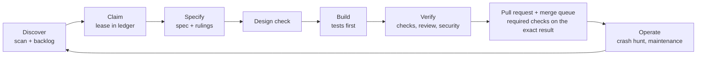

# Agentic PDLC: how Leotheca is delivered

Leotheca is built and maintained by autonomous coding agents under a written, partly machine-enforced product development lifecycle (PDLC). This document describes that lifecycle stage by stage: what a conventional team does, what this repository does instead, and which file or workflow enforces it. It describes only mechanisms that exist on `main`. Section 8 lists what is missing or unproven.

## 1. Summary

|                        |                                                                                                                                                                                                                                                                                                                                                                                          |
| ---------------------- | ---------------------------------------------------------------------------------------------------------------------------------------------------------------------------------------------------------------------------------------------------------------------------------------------------------------------------------------------------------------------------------------- |
| **Thesis**             | Agents deliver at a steady pace only if the process is stricter than a human team's, not looser. Every rule that matters is therefore enforced by something that cannot be talked out of it, with agents doing the judgment work between those controls.                                                                                                                                 |
| **Operating model**    | A "dark factory": agents pick work, specify, build, test, review and deliver through pull requests that a merge queue lands on `main` after the required checks, without a human approval step. A scheduled integrator pass repairs or merges pull requests whose owner is gone. Review is a separate agent pass, not a person. The owner sets direction and policy, and reads outcomes. |
| **What keeps it safe** | One ownership ledger, one constitution, tests that must fail before a fix, hooks and CI that re-check what agents report, and a rule that completion needs evidence, not confidence.                                                                                                                                                                                                     |
| **Design stance**      | Opinionated: spec before code, decisions recorded as rulings, no waiting on people, and no "done" without a named command and its observed output.                                                                                                                                                                                                                                       |

Entry points: [`AGENTS.md`](../AGENTS.md) (startup sequence), [`CONSTITUTION.md`](../CONSTITUTION.md) (policy), [`skills/README.md`](../skills/README.md) (runbooks).

## 2. The loop



## 3. Agents involved

Counts come from `git shortlog` on 2026-11-07. They measure activity, not quality. Agents sometimes commit under the owner's identity, so author counts understate agent work.

| Agent              | Kind        | Runs on                                                                            | Role                                                                                           | Evidence in the history                                                                                      |
| ------------------ | ----------- | ---------------------------------------------------------------------------------- | ---------------------------------------------------------------------------------------------- | ------------------------------------------------------------------------------------------------------------ |
| Leonard Schwier    | Human       | Own workstation                                                                    | Maintainer and architect: sets direction and policy, reads outcomes                            | 907 commits across four author identities, including agent runs that used the owner's identity               |
| LeoHub Hermes      | Local agent | Locally, on one RTX 4090 (24 GB VRAM) with Qwen 3.8 27B                            | Most features, bug fixes, CI/CD and packaging                                                  | 566 commits under the author names Hermes, LeoHub Agent and LeoHub local Hermes, 2026-09-20 to 2026-10-31    |
| opencode           | Local agent | The author's workstation, on the same RTX 4090 with Qwen 3.8 27B                   | Small-model-friendly runs under the same ledger and rules                                      | 5 commits carry an opencode co-author trailer; 5 carry the trailer `qwen/qwen3.6-35b-a3b`                    |
| Mistral Vibe       | Cloud agent | Cloud model                                                                        | Specific roadmap items                                                                         | About 163 commit messages name it; its commits use the owner's identity, so it does not show up as an author |
| Claude Code        | Cloud agent | Anthropic Claude models (Sonnet 5, Sonnet 5.5 and Opus 5.5 appear in the trailers) | Roadmap items across all areas: features, crash reviews, hooks and gates, specs, this document | 765 commits as author `Claude`, 2026-08-27 to 2026-11-06, the largest single author                          |
| ChatGPT automation | Cloud agent | OpenAI models (the history names it Codex and GPT-5)                               | Specific roadmap items                                                                         | 4 commits with a `Codex` co-author trailer and ledger owners named `Codex-GPT5-...`                          |
| Leotheca CI        | Automation  | GitHub Actions                                                                     | Automated verification and release pipeline                                                    | Workflows `CI`, `Rules`, `Agent policy` and `Release` in `.github/workflows/`                                |

The two local agents matter for the process design: a roughly 27B-parameter model on 24 GB of VRAM can only follow short skills and small tasks, so every runbook has to work for it. The trailers of the five opencode commits record `qwen/qwen3.6-35b-a3b`, which differs from the model name the owner states; treat the stated name as unconfirmed until the two agree.

## 4. Two kinds of control

Agentic controls make judgments. Non-agentic controls cannot be argued with. Quality at scale comes from the second kind bounding the first.

| Agentic (judgment)                                         | Non-agentic (enforcement)                                                                                                        |
| ---------------------------------------------------------- | -------------------------------------------------------------------------------------------------------------------------------- |
| Scan competitor changelogs and write backlog entries       | Entry format checked in CI by [`scripts/check_roadmap_format.py`](../scripts/check_roadmap_format.py)                            |
| Write the spec, interrogate it, and rule on open questions | Ownership and leases only change through [`scripts/agent_ledger.py`](../scripts/agent_ledger.py), which has its own tests        |
| Independent review of the diff by a fresh agent            | Pre-commit, commit-msg and pre-push hooks in [`hooks/`](../hooks/README.md), plus a CI backstop in `.github/workflows/rules.yml` |
| Crash-hunting passes in idle time                          | Type check, lint, unit tests and builds in `.github/workflows/ci.yml`                                                            |
| Security review of changed trust boundaries                | Policy workflow `.github/workflows/agent-policy.yml`, including the master-spec check                                            |

## 5. Stage by stage

| Stage                 | Conventional                                        | Here                                                                                                 | Enforced by                                     |
| --------------------- | --------------------------------------------------- | ---------------------------------------------------------------------------------------------------- | ----------------------------------------------- |
| 5.1 Discover          | Product managers read the market and keep a backlog | Agents scan comparable apps' changelogs and write backlog entries filtered by the project principles | Entry-format check in CI                        |
| 5.2 Plan and claim    | Sprint planning and assignment                      | One ledger on remote `main`, with time-limited leases, tokens and declared touch paths               | `scripts/agent_ledger.py` and its tests         |
| 5.3 Specify           | A requirements document reviewed in a meeting       | `spec/<item>.md` first, a grill step, and an LLM judge that records rulings                          | Hard gate in the playbook; master-spec CI check |
| 5.4 Design            | A designer reviews mocks against the design system  | The spec records reuse, add, change or no UI; the shared system is the Leoforma repo                 | Playbook stage 4; Leoforma tests                |
| 5.5 Build             | Engineers implement                                 | Acceptance criteria first, regression test red before the fix, crash-freedom checklist               | Constitution; pre-commit hook                   |
| 5.6 Verify            | QA, code review, security review                    | Checks, independent agent review, e2e smoke, security and text-rights gates                          | Pre-push hook; CI; verification suite           |
| 5.7 Release           | A release manager cuts and checks builds            | Direct push after merge and lease check; CI read for the exact commit                                | CI workflows; blocked-not-done rule             |
| 5.8 Operate and learn | On-call and incident reviews                        | Crash hunting in idle time, committed handoffs, failures written back into the skills                | Maintenance-review skill                        |

### 5.1 Discover and prioritise

| Aspect           | Description                                                                                                                                                                                                                                                                                                                                                                                                                                                                                          |
| ---------------- | ---------------------------------------------------------------------------------------------------------------------------------------------------------------------------------------------------------------------------------------------------------------------------------------------------------------------------------------------------------------------------------------------------------------------------------------------------------------------------------------------------- |
| **Conventional** | product managers read the market, interview users and keep a backlog.                                                                                                                                                                                                                                                                                                                                                                                                                                |
| **Here**         | agents run [`skills/competitor-changelog-scan.md`](../skills/competitor-changelog-scan.md) to find gaps against comparable note apps and write them into [`ROADMAP.md`](../ROADMAP.md) as entries, each filtered through the project's principles in [`PHILOSOPHY.md`](../PHILOSOPHY.md) (plain files, offline, no telemetry). When no feature is runnable, [`skills/maintenance-review.md`](../skills/maintenance-review.md) turns idle capacity into a bounded bug hunt rather than invented work. |
| **Enforced by**  | entry format check in CI; work-selection order in the constitution (main regressions, then bugs, then crash hunting, then features).                                                                                                                                                                                                                                                                                                                                                                 |

### 5.2 Plan and claim

| Aspect           | Description                                                                                                                                                                                                                                                                                                                                                             |
| ---------------- | ----------------------------------------------------------------------------------------------------------------------------------------------------------------------------------------------------------------------------------------------------------------------------------------------------------------------------------------------------------------------- |
| **Conventional** | sprint planning and assignment.                                                                                                                                                                                                                                                                                                                                         |
| **Here**         | the roadmap on remote `main` is the only ownership ledger. A worker claims one item with a time-limited lease and an unpredictable token, declares which files and shared resources it will touch, and renews while it works. Conflicting claims exclude each other. An expired lease lets another worker recover the item, and a dead session's token is never reused. |
| **Enforced by**  | [`scripts/agent_ledger.py`](../scripts/agent_ledger.py) and its tests; the procedure in [`skills/roadmap-workflow.md`](../skills/roadmap-workflow.md). This is a cooperative protocol, not a server-side boundary (see section 8).                                                                                                                                      |

### 5.3 Specify

| Aspect           | Description                                                                                                                                                                                                                                                                                                                                                                                |
| ---------------- | ------------------------------------------------------------------------------------------------------------------------------------------------------------------------------------------------------------------------------------------------------------------------------------------------------------------------------------------------------------------------------------------ |
| **Conventional** | a requirements document reviewed in a meeting.                                                                                                                                                                                                                                                                                                                                             |
| **Here**         | every item gets `spec/<item>.md` before any implementation edit. A "grill" step interrogates the spec for what is missing, and an LLM judge answers its own questions and records each ruling as decision, why, and cost if wrong, including the option to shrink or decline the item. Nobody waits for a person. Finished specs move to [`spec/completed/`](../spec/completed/README.md). |
| **Enforced by**  | hard gate in [`skills/pdlc-playbook.md`](../skills/pdlc-playbook.md). The spec of the whole product is kept in [`master-spec.md`](../master-spec.md); a CI job (`scripts/check_master_spec.py`) fails a code push that does not update it.                                                                                                                                                 |

### 5.4 Design

| Aspect           | Description                                                                                                                                                                                                                                                                                                                                                           |
| ---------------- | --------------------------------------------------------------------------------------------------------------------------------------------------------------------------------------------------------------------------------------------------------------------------------------------------------------------------------------------------------------------- |
| **Conventional** | a designer reviews mocks against the design system.                                                                                                                                                                                                                                                                                                                   |
| **Here**         | the spec records whether the change reuses, adds or changes a design-system element, or has no UI surface. The shared system is its own public repository, [Leoforma](https://github.com/LeonardSchwier/leoforma) (tokens, bundled fonts, accessible Preact components with contrast and axe tests). The app consumes it as an exactly pinned dependency (section 8). |
| **Enforced by**  | playbook stage 4; Leoforma's own test suite.                                                                                                                                                                                                                                                                                                                          |

### 5.5 Build

| Aspect           | Description                                                                                                                                                                                                                                                                                                                                                      |
| ---------------- | ---------------------------------------------------------------------------------------------------------------------------------------------------------------------------------------------------------------------------------------------------------------------------------------------------------------------------------------------------------------- |
| **Conventional** | engineers implement, with tests of varying rigor.                                                                                                                                                                                                                                                                                                                |
| **Here**         | acceptance criteria are written first. A bug fix must come with a regression test that fails without the fix and passes with it. A crash-freedom checklist (unhandled rejection, lifecycle, boundary inputs, concurrency, platform no-op, recovery) applies to every user-reachable change. Paths and handles coming from the frontend are untrusted by default. |
| **Enforced by**  | [`CONSTITUTION.md`](../CONSTITUTION.md), [`skills/crash-freedom.md`](../skills/crash-freedom.md), [`skills/change-quality-gates.md`](../skills/change-quality-gates.md); pre-commit hook checks staged files and scans for secrets.                                                                                                                              |

### 5.6 Verify

| Aspect             | Description                                                                                                                                                                                                                                                                                                                                                                                                                                                                                                                                                                                                                                                                                                                                                                                                     |
| ------------------ | --------------------------------------------------------------------------------------------------------------------------------------------------------------------------------------------------------------------------------------------------------------------------------------------------------------------------------------------------------------------------------------------------------------------------------------------------------------------------------------------------------------------------------------------------------------------------------------------------------------------------------------------------------------------------------------------------------------------------------------------------------------------------------------------------------------- |
| **Conventional**   | QA, code review, a security review before release.                                                                                                                                                                                                                                                                                                                                                                                                                                                                                                                                                                                                                                                                                                                                                              |
| **Here, in order** | the checks in [`skills/verification-suite.md`](../skills/verification-suite.md) for the changed surface (type check, lint, unit tests, build; Rust and Android checks when touched); an independent review by a fresh agent that gets a crafted brief and not the session history, with findings ranked and a capped fix loop; end-to-end smoke tests of core journeys; then the security gate in [`skills/security-and-static-analysis.md`](../skills/security-and-static-analysis.md) and the text-rights check in [`skills/text-rights-and-legal-check.md`](../skills/text-rights-and-legal-check.md), which fixes its own findings instead of escalating them. Completion is a table of claims against the exact command and observed result. Words such as "should work" are banned until evidence exists. |
| **Enforced by**    | `hooks/pre-push` runs [`scripts/verify-fast.sh`](../scripts/verify-fast.sh) and refuses force pushes and deletion of `main`; [`skills/pre-push-verification.md`](../skills/pre-push-verification.md) records the real incidents that motivated it.                                                                                                                                                                                                                                                                                                                                                                                                                                                                                                                                                              |

### 5.7 Release

| Aspect           | Description                                                                                                                                                                                                                                                                                                                                                                                                                                 |
| ---------------- | ------------------------------------------------------------------------------------------------------------------------------------------------------------------------------------------------------------------------------------------------------------------------------------------------------------------------------------------------------------------------------------------------------------------------------------------- |
| **Conventional** | a release manager cuts and checks builds.                                                                                                                                                                                                                                                                                                                                                                                                   |
| **Here**         | agents push to `main` after merging the latest `main` into their candidate and re-checking their lease. They then inspect CI for the exact landed commit, not the latest run, and fix their own failures before taking new work. Packaging for Linux, macOS, Windows and Android follows [`skills/packaging-submission-pipelines.md`](../skills/packaging-submission-pipelines.md); builds are produced by `.github/workflows/release.yml`. |
| **Enforced by**  | CI workflows; `.github/pull_request_template.md` (Summary, Evidence, Merge danger) checked by `check-rules.mjs prbody`; the rule that an unverified landing stays blocked, never "done".                                                                                                                                                                                                                                                    |

### 5.8 Operate and learn

| Aspect           | Description                                                                                                                                                                                                                                                                                                                                                                                                                                                                                                                                             |
| ---------------- | ------------------------------------------------------------------------------------------------------------------------------------------------------------------------------------------------------------------------------------------------------------------------------------------------------------------------------------------------------------------------------------------------------------------------------------------------------------------------------------------------------------------------------------------------------- |
| **Conventional** | on-call, incident reviews, quarterly cleanups.                                                                                                                                                                                                                                                                                                                                                                                                                                                                                                          |
| **Here**         | the standing mission is a crash-free `main`. Idle capacity runs crash-hunting passes on the highest-risk paths; each proven defect lands with its regression test, and each review records what it did not examine. Handoffs are committed files in `.agents/handoffs/`, so a lost session is recoverable, and recurring failures are written back into the skills. Every item ends with a stage 8 reflection line, which a push check requires before a spec is archived, and agents may change the process itself when an item shows a rule is wrong. |
| **Enforced by**  | [`skills/maintenance-review.md`](../skills/maintenance-review.md), [`skills/autonomous-roadmap-delivery.md`](../skills/autonomous-roadmap-delivery.md), `scripts/check-rules.mjs reflection`.                                                                                                                                                                                                                                                                                                                                                           |

### Ideas adopted from public work

The shared glossary (`GLOSSARY.md`, read at startup and extended by the grill stage, with `scripts/check-rules.mjs glossary` failing an archived spec that lacks a `Glossary:` line) takes its idea from the `grill-with-docs` and `domain-modeling` skills in the public `mattpocock/skills` repository (MIT licence). Only the idea is used; no text or code was copied.

## 6. Why it holds with many agents at once

1. **One writer per resource.** Claims name files and shared contracts; overlap is rejected by the helper.
2. **Leases, not trust.** Work stops when a lease expires; recovery needs a fresh token.
3. **Evidence over reports.** A success claim from an agent is rechecked by hooks and CI, and a missing check is recorded as missing.
4. **No history rewrites.** No force pushes, no bypassing hooks, no discarding another agent's changes.
5. **Small, tool-neutral runbooks.** Skills are short Markdown files usable by any runner.

## 7. Runner and hardware constraint

The process is provider-neutral and also designed to run from the author's local setup: opencode on one NVIDIA RTX 4090 (24 GB) with a local Qwen 3.8 27B model. That is why skills are short and tasks small, and why a check that cannot run locally must be reported as not run, never as green. See the "Author environment and runners" section of the constitution.

## 8. Limits and open gaps

| Gap                                                       | State                                                                                                                                                                                                                                                                                                                                                                                                                                                                                                                                                                                                                                                                                                                                                                                                                                                                                                                                                                                                                                                                                                                                                                 | Resolution                                                                                                                                                                                                        |
| --------------------------------------------------------- | --------------------------------------------------------------------------------------------------------------------------------------------------------------------------------------------------------------------------------------------------------------------------------------------------------------------------------------------------------------------------------------------------------------------------------------------------------------------------------------------------------------------------------------------------------------------------------------------------------------------------------------------------------------------------------------------------------------------------------------------------------------------------------------------------------------------------------------------------------------------------------------------------------------------------------------------------------------------------------------------------------------------------------------------------------------------------------------------------------------------------------------------------------------------- | ----------------------------------------------------------------------------------------------------------------------------------------------------------------------------------------------------------------- |
| End-to-end smoke suite                                    | 14 journeys are on `main` (`tests/e2e`) and run as the required `e2e` CI job, which uploads traces on failure (green on `07f7a65`). They also run in the pre-push gate through the root `npm run test:e2e` script when a Playwright browser is installed. One finding is open: after an edit is pending, a second key press freezes headless Chromium with no cause found, so the autosave test inserts text in one input event. `tests/ui` holds an older script outside CI.                                                                                                                                                                                                                                                                                                                                                                                                                                                                                                                                                                                                                                                                                         | Roadmap: retire `tests/ui` once each of its tests has an e2e journey; find the cause of the typing freeze.                                                                                                        |
| Hosted CI evidence                                        | Hosted runs can queue for a long time, so a landed commit is sometimes recorded as blocked until its runs finish. Read the ledger note of an item for the run IDs it was finished with.                                                                                                                                                                                                                                                                                                                                                                                                                                                                                                                                                                                                                                                                                                                                                                                                                                                                                                                                                                               | Done: `scripts/check_ledger_evidence.py` on every push and a weekly `ledger-audit` job require a run id in the finish note.                                                                                       |
| Security tooling                                          | The security-audit skill is installed at user level (verified MIT source, commit c1c8a8c) and one Tier 1 guidance run covered the Tauri commands and capabilities, the Capacitor plugins and the AndroidManifest; the first Tier 2 audit ran on 2026-11-08 (standard profile, condensed, partial coverage): 4 confirmed (1 medium, 3 low), 3 needs_validation, and three medium-class items seeded. Secret scanning is wired (gitleaks 8.30.1 in the pre-commit hook when installed, and the `gitleaks` workflow over the tree, each pull request and weekly history; narrow allowlists in `.gitleaks.toml`). Rust dependencies are audited by a `cargo-audit` job (0 vulnerabilities, 13 unmaintained, unsound or yanked warnings on 2026-11-07; `tokio` 1.53.1 is flagged unsound). Production npm dependencies are clean (`npm audit --omit=dev` reports 0 on 2026-11-07) and the `audit.yml` workflow re-checks weekly. These jobs are not required checks. SAST is wired: `eslint-plugin-security` in `npm run lint` (one real quadratic-regex defect found and fixed), the `semgrep` workflow (0 open findings) and the `codeql` workflow; Android lint is not. | Roadmap: Android lint in CI, the first full Tier 2 audit. Done: gitleaks, `cargo audit`, the npm audit gate; the dependency-intake line is checked by `check-rules.mjs`.                                          |
| Design system adoption                                    | The app consumes Leoforma as a pinned release tarball (lockfile integrity, offline Flatpak cache entries). EmptyState and the icon set are now Leoforma's; Sheet and StatusIndicator followed. GitHub tag archives are not promised to be byte-stable, so a failed integrity check means re-cutting the tag.                                                                                                                                                                                                                                                                                                                                                                                                                                                                                                                                                                                                                                                                                                                                                                                                                                                          | Remaining leftovers are small roadmap items.                                                                                                                                                                      |
| Open security findings                                    | The guidance run produced four findings. All four are fixed in code: the `list_dir` gate, the workspace-root grant registry, the speech model allow-list and the Android share-URI policy. The Android fix is unit-tested but has not run on a device.                                                                                                                                                                                                                                                                                                                                                                                                                                                                                                                                                                                                                                                                                                                                                                                                                                                                                                                | Done. A device run of the share path is still wanted.                                                                                                                                                             |
| Legal and text-rights check, database best-practice skill | Both skills are in the repository and the legal check is step 5 of stage 6. A push that touches the matching files must carry a trailer with the result, which is checked mechanically; the content of the result is still the agent's own judgment.                                                                                                                                                                                                                                                                                                                                                                                                                                                                                                                                                                                                                                                                                                                                                                                                                                                                                                                  | Done: `Legal-Check:` and `Database-Review:` trailers are required by `scripts/check-rules.mjs trailers` in pre-push and the Rules workflow.                                                                       |
| Enforcement model                                         | Code reaches `main` only through pull requests and the pre-push hook refuses a direct push, but the server does not yet enforce it: auto-merge and the `main` ruleset are owner settings that are not enabled. The ownership ledger lives on its own branch and stays a cooperative protocol among compliant runners.                                                                                                                                                                                                                                                                                                                                                                                                                                                                                                                                                                                                                                                                                                                                                                                                                                                 | Decided in `documentation/BRANCH_MODEL.md` and `documentation/DECISIONS.md` (2026-11-07). Open: the owner enables the ruleset; until then the Rules workflow, the evidence check and the weekly audit compensate. |
| Independence of review                                    | Review is by a separate agent, which reduces but does not remove correlated errors with the author model.                                                                                                                                                                                                                                                                                                                                                                                                                                                                                                                                                                                                                                                                                                                                                                                                                                                                                                                                                                                                                                                             | Partly: the `Review:` trailer names the reviewer or says `self-review` with a reason. It makes self-review visible, it does not force a second model.                                                             |

## 9. Check these claims yourself

```sh
python3 scripts/agent_ledger.py --root . list        # ownership ledger state
python3 -m unittest discover -s scripts -p 'test_agent_ledger.py' -v
python3 scripts/check_roadmap_format.py --root .     # backlog entry format
python3 scripts/check_master_spec.py --root .        # master spec consistency
npm run hooks:install && cat hooks/README.md         # local enforcement and bypass policy
```
