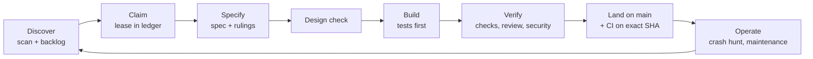

# Agentic PDLC: how Leotheca is delivered

Leotheca is built and maintained by autonomous coding agents under a written, partly machine-enforced product development lifecycle (PDLC). This document describes that lifecycle stage by stage: what a conventional team does, what this repository does instead, and which file or workflow enforces it. It describes only mechanisms that exist on `main`. Section 7 lists what is missing or unproven.

## 1. Summary

|                        |                                                                                                                                                                                                                                                          |
| ---------------------- | -------------------------------------------------------------------------------------------------------------------------------------------------------------------------------------------------------------------------------------------------------- |
| **Thesis**             | Agents deliver at a steady pace only if the process is stricter than a human team's, not looser. Every rule that matters is therefore enforced by something that cannot be talked out of it, with agents doing the judgment work between those controls. |
| **Operating model**    | A "dark factory": agents pick work, specify, build, test, review and push directly to `main` without a human approval step. Review is a separate agent pass, not a person. The owner sets direction and policy, and reads outcomes.                      |
| **What keeps it safe** | One ownership ledger, one constitution, tests that must fail before a fix, hooks and CI that re-check what agents report, and a rule that completion needs evidence, not confidence.                                                                     |
| **Design stance**      | Opinionated: spec before code, decisions recorded as rulings, no waiting on people, and no "done" without a named command and its observed output.                                                                                                       |

Entry points: [`AGENTS.md`](../AGENTS.md) (startup sequence), [`CONSTITUTION.md`](../CONSTITUTION.md) (policy), [`skills/README.md`](../skills/README.md) (runbooks).

## 2. The loop



## 3. Two kinds of control

Agentic controls make judgments. Non-agentic controls cannot be argued with. Quality at scale comes from the second kind bounding the first.

| Agentic (judgment)                                         | Non-agentic (enforcement)                                                                                                        |
| ---------------------------------------------------------- | -------------------------------------------------------------------------------------------------------------------------------- |
| Scan competitor changelogs and write backlog entries       | Entry format checked in CI by [`scripts/check_roadmap_format.py`](../scripts/check_roadmap_format.py)                            |
| Write the spec, interrogate it, and rule on open questions | Ownership and leases only change through [`scripts/agent_ledger.py`](../scripts/agent_ledger.py), which has its own tests        |
| Independent review of the diff by a fresh agent            | Pre-commit, commit-msg and pre-push hooks in [`hooks/`](../hooks/README.md), plus a CI backstop in `.github/workflows/rules.yml` |
| Crash-hunting passes in idle time                          | Type check, lint, unit tests and builds in `.github/workflows/ci.yml`                                                            |
| Security review of changed trust boundaries                | Policy workflow `.github/workflows/agent-policy.yml`, including the master-spec check                                            |

## 4. Stage by stage

### 4.1 Discover and prioritise

- **Conventional:** product managers read the market, interview users and keep a backlog.
- **Here:** agents run [`skills/competitor-changelog-scan.md`](../skills/competitor-changelog-scan.md) to find gaps against comparable note apps and write them into [`ROADMAP.md`](../ROADMAP.md) as entries, each filtered through the project's principles in [`PHILOSOPHY.md`](../PHILOSOPHY.md) (plain files, offline, no telemetry). When no feature is runnable, [`skills/maintenance-review.md`](../skills/maintenance-review.md) turns idle capacity into a bounded bug hunt rather than invented work.
- **Enforced by:** entry format check in CI; work-selection order in the constitution (main regressions, then bugs, then crash hunting, then features).

### 4.2 Plan and claim

- **Conventional:** sprint planning and assignment.
- **Here:** the roadmap on remote `main` is the only ownership ledger. A worker claims one item with a time-limited lease and an unpredictable token, declares which files and shared resources it will touch, and renews while it works. Conflicting claims exclude each other. An expired lease lets another worker recover the item, and a dead session's token is never reused.
- **Enforced by:** [`scripts/agent_ledger.py`](../scripts/agent_ledger.py) and its tests; the procedure in [`skills/roadmap-workflow.md`](../skills/roadmap-workflow.md). This is a cooperative protocol, not a server-side boundary (see section 7).

### 4.3 Specify

- **Conventional:** a requirements document reviewed in a meeting.
- **Here:** every item gets `spec/<item>.md` before any implementation edit. A "grill" step interrogates the spec for what is missing, and an LLM judge answers its own questions and records each ruling as decision, why, and cost if wrong, including the option to shrink or decline the item. Nobody waits for a person. Finished specs move to [`spec/completed/`](../spec/completed/README.md).
- **Enforced by:** hard gate in [`skills/pdlc-playbook.md`](../skills/pdlc-playbook.md). The spec of the whole product is kept in [`master-spec.md`](../master-spec.md); a CI job (`scripts/check_master_spec.py`) fails a code push that does not update it.

### 4.4 Design

- **Conventional:** a designer reviews mocks against the design system.
- **Here:** the spec records whether the change reuses, adds or changes a design-system element, or has no UI surface. The shared system is its own public repository, [Leoforma](https://github.com/LeonardSchwier/leoforma) (tokens, bundled fonts, accessible Preact components with contrast and axe tests). Moving the app onto it as a pinned dependency is in progress (section 7).
- **Enforced by:** playbook stage 4; Leoforma's own test suite.

### 4.5 Build

- **Conventional:** engineers implement, with tests of varying rigor.
- **Here:** acceptance criteria are written first. A bug fix must come with a regression test that fails without the fix and passes with it. A crash-freedom checklist (unhandled rejection, lifecycle, boundary inputs, concurrency, platform no-op, recovery) applies to every user-reachable change. Paths and handles coming from the frontend are untrusted by default.
- **Enforced by:** [`CONSTITUTION.md`](../CONSTITUTION.md), [`skills/crash-freedom.md`](../skills/crash-freedom.md), [`skills/change-quality-gates.md`](../skills/change-quality-gates.md); pre-commit hook checks staged files and scans for secrets.

### 4.6 Verify

- **Conventional:** QA, code review, a security review before release.
- **Here, in order:** the checks in [`skills/verification-suite.md`](../skills/verification-suite.md) for the changed surface (type check, lint, unit tests, build; Rust and Android checks when touched); an independent review by a fresh agent that gets a crafted brief and not the session history, with findings ranked and a capped fix loop; end-to-end smoke tests of core journeys; then the security gate in [`skills/security-and-static-analysis.md`](../skills/security-and-static-analysis.md) and the text-rights check in [`skills/text-rights-and-legal-check.md`](../skills/text-rights-and-legal-check.md), which fixes its own findings instead of escalating them. Completion is a table of claims against the exact command and observed result. Words such as "should work" are banned until evidence exists.
- **Enforced by:** `hooks/pre-push` runs [`scripts/verify-fast.sh`](../scripts/verify-fast.sh) and refuses force pushes and deletion of `main`; [`skills/pre-push-verification.md`](../skills/pre-push-verification.md) records the real incidents that motivated it.

### 4.7 Release

- **Conventional:** a release manager cuts and checks builds.
- **Here:** agents push to `main` after merging the latest `main` into their candidate and re-checking their lease. They then inspect CI for the exact landed commit, not the latest run, and fix their own failures before taking new work. Packaging for Linux, macOS, Windows and Android follows [`skills/packaging-submission-pipelines.md`](../skills/packaging-submission-pipelines.md); builds are produced by `.github/workflows/release.yml`.
- **Enforced by:** CI workflows; the rule that an unverified landing stays marked blocked with a retry command, never "done".

### 4.8 Operate and learn

- **Conventional:** on-call, incident reviews, quarterly cleanups.
- **Here:** the standing mission is a crash-free `main`. Idle capacity runs crash-hunting passes on the highest-risk paths; each proven defect lands with its regression test, and each review records what it did not examine. Handoffs are committed files in `.agents/handoffs/`, so a lost session is recoverable, and recurring failures are written back into the skills.
- **Enforced by:** [`skills/maintenance-review.md`](../skills/maintenance-review.md), [`skills/autonomous-roadmap-delivery.md`](../skills/autonomous-roadmap-delivery.md).

## 5. Why it holds with many agents at once

1. **One writer per resource.** Claims name files and shared contracts; overlap is rejected by the helper.
2. **Leases, not trust.** Work stops when a lease expires; recovery needs a fresh token.
3. **Evidence over reports.** A success claim from an agent is rechecked by hooks and CI, and a missing check is recorded as missing.
4. **No history rewrites.** No force pushes, no bypassing hooks, no discarding another agent's changes.
5. **Small, tool-neutral runbooks.** Skills are short Markdown files usable by any runner.

## 6. Runner and hardware constraint

The process is provider-neutral and also designed to run from the author's local setup: opencode on one NVIDIA RTX 4090 (24 GB) with a local Qwen model of about 27B parameters (the model name is as given by the author and is unverified). That is why skills are short and tasks small, and why a check that cannot run locally must be reported as not run, never as green. See the "Author environment and runners" section of the constitution.

## 7. Limits and open gaps

| Gap                                                       | State                                                                                                                                                                                                                                                                                                                                                                                                                      |
| --------------------------------------------------------- | -------------------------------------------------------------------------------------------------------------------------------------------------------------------------------------------------------------------------------------------------------------------------------------------------------------------------------------------------------------------------------------------------------------------------- |
| End-to-end smoke suite                                    | 14 journeys are on `main` (`tests/e2e`) and run as the required `e2e` CI job, which uploads traces on failure (green on `07f7a65`). They are not yet in the pre-push gate (no root `test:e2e` script). One finding is open: after an edit is pending, a second key press freezes headless Chromium with no cause found, so the autosave test inserts text in one input event. `tests/ui` holds an older script outside CI. |
| Hosted CI evidence                                        | At the time of writing several landed commits had CI queued, so they are not claimed as hosted-green.                                                                                                                                                                                                                                                                                                                      |
| Security tooling                                          | The security-audit workflow is documented but no full audit has been run. Secret scanning, dependency auditing as a blocking gate, and SAST tools are seeded in the roadmap, not wired. `npm audit` currently reports findings that are untriaged.                                                                                                                                                                         |
| Design system adoption                                    | Leoforma is published; the app does not yet consume it as a pinned dependency.                                                                                                                                                                                                                                                                                                                                             |
| Legal and text-rights check, database best-practice skill | Both skills are in the repository and the legal check is step 5 of stage 6. They are procedures run by agents, with no hook or CI job enforcing them yet.                                                                                                                                                                                                                                                                  |
| Enforcement model                                         | The ledger is a cooperative protocol among compliant runners, not a server-enforced boundary. Branch protection is not used.                                                                                                                                                                                                                                                                                               |
| Independence of review                                    | Review is by a separate agent, which reduces but does not remove correlated errors with the author model.                                                                                                                                                                                                                                                                                                                  |

## 8. Check these claims yourself

```sh
python3 scripts/agent_ledger.py --root . list        # ownership ledger state
python3 -m unittest discover -s scripts -p 'test_agent_ledger.py' -v
python3 scripts/check_roadmap_format.py --root .     # backlog entry format
python3 scripts/check_master_spec.py --root .        # master spec consistency
npm run hooks:install && cat hooks/README.md         # local enforcement and bypass policy
```
